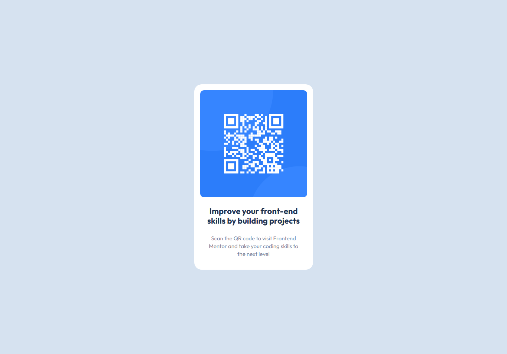
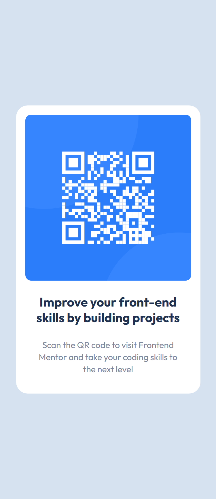

# QR code component

This is my solution to the [QR code component challenge](https://www.frontendmentor.io/challenges/qr-code-component-iux_sIO_H) from Frontend Mentor. I built it to practice HTML5 and CSS3, with a responsive layout that works on desktop and mobile.

## Technologies Used

- Semantic HTML5
- CSS3 (custom properties, Flexbox, Grid)
- BEM-style class names

## Links

- [Live preview](https://jfrancodardengo.github.io/qrcode-component/)

## What I learned

- I learned the concept of color variables in CSS. By using color variables, if more than one place in the project is using the same color, I can change the color at a single point in the project, and all places that use that color as a reference will be changed.
- I learned about using class selectors instead of tags. In larger projects, not using class selectors can lead to confusion when styling or applying a specific function to the selector, causing the opposite effect of what was intended.
- It's best practice to use `max-width` instead of `width: 22%`. Since the percentage increases with the screen width, the card would shrink too much on small screens, and the `max-width` setting defines a limit for the card to grow without making it tiny.
- The card was not centered because `align-items` was applied to an element that was not a flex container. I fixed it by applying the alignment to the correct container (``main`)

## What I would improve next

- I want to study `media queries` to adapt the layout to more screen sizes.

## Author

Made by **José Augusto Franco Dardengo**  

